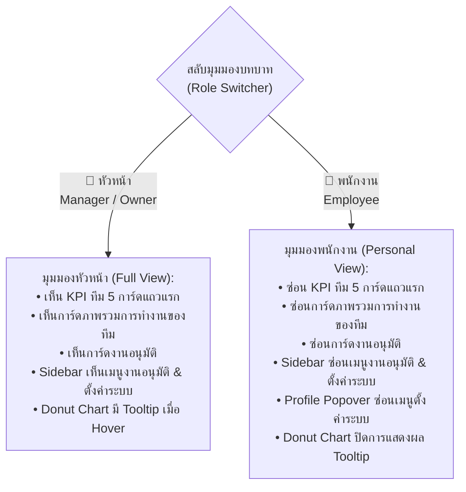

# CKACE HR — Dashboard Design Specification & Standard Lock (Design.md)

> **สถานะเอกสาร:** 🔒 **LOCKED & ACCEPTED STANDARD (เวอร์ชันมาตรฐานสมบูรณ์)**  
> **วันที่มีผลบังคับใช้:** 30 ตุลาคม 2569 (2026-10-30)  
> **ผลิตภัณฑ์:** CKACE HR Enterprise Portal (ระบบบริหารงานบุคคลและแดชบอร์ดผู้บริหาร/พนักงาน)  
> **สไตล์หลัก:** SmartHR Light-Blue Corporate Clean (โทนสีฟ้าพาสเทลร่วมสมัย สะอาด สบายตา คมชัด เป็นมืออาชีพ)  
> **ไฟล์ต้นแบบหลัก (Single Source of Truth):**  
> [`docs/design/ui-smarthr-lightblue-20261026/owner-dashboard-preview.html`](./docs/design/ui-smarthr-lightblue-20261026/owner-dashboard-preview.html)

---

## 1. ลิงก์และช่องทางการเข้าชม (Live Links & Environments)

| สภาพแวดล้อม | URL / เส้นทางไฟล์ | รายละเอียด |
| :--- | :--- | :--- |
| **Local Preview (Browser)** | `file:///D:/CKACE_HR.worktrees/ux-ui/docs/design/ui-smarthr-lightblue-20261026/owner-dashboard-preview.html#overview` | เปิดดูในเครื่องได้ทันที รองรับ 100% Offline (มี Base64 Fallback) |
| **GitHub Repository** | `https://github.com/Panuphan-CK/ckace-hr` | สาขาหลัก: `codex/ui-smarthr-lightblue` |
| **GitHub Pages Preview** | `https://panuphan-ck.github.io/ckace-hr-design-preview/owner-dashboard-preview.html` | ตัวอย่าง Live Demo ออนไลน์ |

---

## 2. อัตลักษณ์องค์กรและโลโก้ (Corporate Brand Identity Lock)

- **โลโก้ประจำระบบ:** โลโก้ทางการ **`CK.%ACE ACCOUNTING`**
- **สัญลักษณ์สี:** น้ำเงินเข้มคอร์ปอเรต (`#0b3b68` / `#1b4580`) ตัดกับสีทองหรูหรา (`#d4a34b`)
- **การจัดวางใน Sidebar:**
  - **ขนาดก่อนย่อ (Expanded):** `max-width: 155px; max-height: 46px;` วางมุมซ้ายบนอย่างพอดีกับความกว้าง Sidebar 180px ไม่เหลือขอบขาวส่วนเกิน
  - **ขนาดเมื่อย่อ (Collapsed):** `max-width: 52px; max-height: 26px; margin: 0 auto;`
  - **Fallback Redundancy:** มีการฝัง Base64 Data URI ไว้ใน `onerror` เพื่อให้แสดงผลได้ 100% แม้เปิดไฟล์ผ่านโปรโตคอล `file:///` โดยไม่มีเว็บเซิร์ฟเวอร์

---

## 3. สถาปัตยกรรมเลย์เอาต์และระบบกริด (Layout & Responsive Architecture)

### 3.1 การจัดสัดส่วน Sidebar & Workspace
- **ความกว้าง Sidebar ก่อนย่อ (Expanded):** ล็อกไว้ที่ **`180px`**  
  *(Padding ซ้าย-ขวา ข้างละ 10px ทำให้พื้นที่ด้านในเท่ากับ 160px พอดีกับความกว้างของโลโก้ 125-155px อย่างลงตัว)*
- **ความกว้าง Sidebar เมื่อย่อ (Collapsed):** ล็อกไว้ที่ **`76px`**
- **ความลื่นไหลของการย่อ-ขยาย:** ใช้ CSS Transition `grid-template-columns 0.25s cubic-bezier(0.4, 0, 0.2, 1);`
- **ปุ่มแถวล่างของ Sidebar (กระดิ่ง / เปลี่ยนแอป / รูปโปรไฟล์):**
  - ล็อกขนาดปุ่มเป็น `36px × 36px` เท่ากันทุกปุ่ม
  - ใช้ `display: flex !important; justify-content: space-between !important; flex-wrap: nowrap !important;`
  - ใช้ `flex-shrink: 0 !important;` เพื่อป้องกันการบีบอัด
  - **Zero Collision Guarantee:** ผลรวมความกว้างของปุ่ม $36 \times 3 = 108\text{px}$ จากพื้นที่ใช้งาน $160\text{px}$ เหลือช่องว่างระยะห่าง $52\text{px}$ (เฉลี่ยข้างละ 26px) ป้องกันการซ้อนทับกันอย่างเด็ดขาด 100%

### 3.2 ความยืดหยุ่นเต็มหน้าจอ (Fluid Full-Width & Responsiveness)
- เลิกใช้ขอบเขตจำกัด `max-width: 1540px` บนแดชบอร์ดหลัก โดยเปลี่ยนเป็น `width: 100%; max-width: none;` เพื่อให้เนื้อหากระจายตัวเต็มพื้นที่หน้าจอบนจอกว้าง (Ultrawide)
- รองรับขนาดหน้าจอทุกระดับ:
  - **Desktop (> 850px):** เลย์เอาต์เต็มรูปแบบ 5-6 คอลัมน์ตามโครงสร้างหลัก
  - **Tablet (<= 850px):** ปรับการ์ดหลักเป็น 2 คอลัมน์ และจัดระยะขอบ padding ให้กระชับ
  - **Mobile (<= 620px):** ปรับเป็น 1 คอลัมน์เดี่ยว ย่อแถบนำทางอัตโนมัติ

---

## 4. โครงสร้าง 2 มุมมองการใช้งาน (Dual-Role View Lock)

ระบบได้ออกแบบ **Role Switcher Toolbar** (สำหรับใช้ทดสอบการออกแบบ) อยู่มุมบนขวาของหน้าแดชบอร์ด โดยมีกฎการแสดงผลที่ล็อกไว้ดังนี้:

### สรุปกฎการแสดงผลสำหรับบทบาทพนักงาน (Employee View Rules):
1. **ซ่อนการ์ดดัชนีชี้วัดทีม (5 Team KPI Cards):** แถวแรกที่สรุปยอดทั้งองค์กรจะไม่ปรากฏแก่พนักงานทั่วไป
2. **ซ่อนการ์ด "ภาพรวมการทำงานของทีม":** ไม่เปิดเผยข้อมูลอัตรากำลังและเปอร์เซ็นต์ทีม
3. **ซ่อนการ์ด "งานอนุมัติ":** ไม่แสดงรายการรออนุมัติของผู้อื่น
4. **ซ่อนเมนูใน Sidebar:**
   - ซ่อนเมนู `งานอนุมัติ` (`#nav-approvals-link`)
   - ซ่อนหมวดหมู่ `ADMINISTRATION` (`#nav-admin-label`) และเมนู `ตั้งค่าระบบ [Codex]` (`#nav-settings-link`)
5. **ซ่อนใน Popover บัญชีผู้ใช้งาน:** ซ่อนปุ่มลิงก์ `ตั้งค่าระบบ` (`#pf-settings-link`)
6. **ปิดการทำงาน Tooltip ใน Donut Chart:** เมื่อพนักงานนำเมาส์ไปชี้ที่สัดส่วนการลา จะไม่ปรากฏกล่อง Tooltip แสดงรายชื่อพนักงานที่ลา (To-list) เพื่อรักษาความเป็นส่วนตัวของเพื่อนร่วมงาน

---

## 5. ลำดับส่วนประกอบหน้าแดชบอร์ด (Component Hierarchy Lock)

### Row 1: ทักทายผู้ใช้งาน (Hero) & การ์ดลงเวลาเข้า-ออกงาน
- **ฝั่งซ้าย (Hero Welcome):**
  - ข้อความหัวเรื่อง: `สวัสดีครับ` ขนาดใหญ่ หนา เด่นชัด
  - ชื่อผู้ใช้งาน: `คุณภาณุพันธุ์ ใจดี` พร้อมป้ายตำแหน่ง `เจ้าหน้าที่ทรัพยากรบุคคล`
  - นาฬิกาดิจิทัล Real-time: แสดงวัน เดือน ปี พ.ศ. และเวลาเดินวินาทีสดแบบ Tabular Numbers ไม่สั่นไหว
- **ฝั่งขวา (บันทึกลงเวลา):**
  - ไม่แสดงข้อความหัวเรื่องซ้ำซ้อน
  - แสดงเวลาเข้างานจริง: `08:28:30 น.` พร้อมป้ายสถานะสีเขียว `✓ ตรงเวลา` จัดชิดขวา
  - แสดงเวลาออกงาน: `--:--:-- น.` พร้อมป้าย `ยังไม่ลงเวลา`

### Row 2: ดัชนีชี้วัดภาพรวมทีม (5 Team KPI Stat Cards) *(แสดงเฉพาะหัวหน้า)*
ประกอบด้วย 5 การ์ดไอคอนสีเฉพาะกลุ่ม พร้อมเปอร์เซ็นต์เทียบวันก่อนหน้า:
1. **พนักงานทั้งหมด:** `103 คน` (สีน้ำเงินคอร์ปอเรต `#1e70bf`)
2. **พร้อมทำงาน:** `86 คน` (สีเขียว `#0d8268` | ป้าย `↑ 2.4%`)
3. **ลาวันนี้:** `6 คน` (สีส้ม `#ea580c` | ป้าย `↓ 1.2%`)
4. **ลงเวลา:** `98.6%` (สีฟ้า `#0284c7` | ป้าย `↑ 1.5%`)
5. **รออนุมัติ:** `8 รายการ` (สีส้มแอมเบอร์ `#b45309` | ป้าย `↓ 12.5%`)

### Row 2.5: ดัชนีชี้วัดส่วนบุคคล (6 Personal KPI Stat Cards) *(ตัวชี้วัดของฉัน)*
- หัวข้อกลุ่ม: `ตัวชี้วัดของฉัน` ใช้ฟอนต์สีดำเข้ม (`#1e293b`) สะอาดตา นำข้อความภาษาอังกฤษและปีออก
- ระยะห่าง (Margin): ลดระยะห่างให้กระชับสมดุลรับกับกรอบถัดไป
- ประกอบด้วย 6 การ์ดข้อมูลส่วนบุคคล:
  1. **ลาพักร้อน:** ใช้ไป `3 วัน` / คงเหลือ `12 วัน`
  2. **ลาป่วย:** ใช้ไป `1 วัน` / คงเหลือ `29 วัน`
  3. **ลากิจ:** ใช้ไป `0 วัน` / คงเหลือ `3 วัน`
  4. **ชั่วโมง OT สะสม:** `42.5 ชม.` (ในรอบเดือนปัจจุบัน)
  5. **สถิติการลงเวลา:** ตรงเวลา `98.6%` (มาสาย 1 ครั้ง)
  6. **เบิกค่ารักษา:** เบิกแล้ว `฿2,500` / คงเหลือ `฿7,500`

### Row 3: 4 บอร์ดการทำงานหลัก (Main Deck Boards)
1. **ภาพรวมการทำงานของทีม:** แสดงอัตราความพร้อม `92%` พร้อมหลอดแจกแจงสถานะ *(ซ่อนในมุมมองพนักงาน)*
2. **คำขอของฉัน (My Requests):**
   - แสดง 3 รายการคำขอล่าสุดพร้อมไอคอนชัดเจน
   - ป้ายสถานะอยู่มุมขวาบน: `อนุมัติ` (เขียว), `ยกเลิก` (แดง Outline), `รออนุมัติ` (ส้มแอมเบอร์)
   - ข้อมูลคำขอ: รหัสเอกสาร วันที่ขอ วันที่ลา และเหตุผล จัดขอบตรงกันอ่านง่าย
3. **สถิติการลา (Leave Statistics):**
   - แสดงยอดลารวม `6 คน` (คำว่า "คน" เป็นสีดำมาตรฐาน)
   - กราฟ Donut Chart แยกประเภทการลาชัดเจน
4. **สถิติการลาของฉัน (My Leave Quota):**
   - แสดงหลอดสิทธิ์การลา 3 ประเภทหลัก
   - ข้อความตัวเอียงหนาวิ่งตามปลายหลอด เช่น `ใช้ไป 3/15 (20%)` และ `คงเหลือ 12 วัน (80%)`

### Row 4: 3 การ์ดการวิเคราะห์เชิงลึก (Deep Insight Row)
*หลอด Progress และกล่องสรุปด้านล่างของการ์ดแถวนี้ล็อกระดับความสูงและตำแหน่งเริ่มต้น-สิ้นสุดตรงกันในระดับพิกเซล:*
1. **สรุปชั่วโมง OT (OT Analytics):**
   - สถิติสะสม `42.5 ชม.`
   - กราฟแท่ง 7 วัน สัดส่วนสูงเต็มพื้นที่ (`height: 172px`) แสดงตัวเลขชั่วโมงในแท่ง
2. **ลงเวลาวันนี้ (Attendance Today):**
   - อัตราลงเวลา `98.6%`
   - หลอดแสดงอัตราส่วน `86/103 คน` (`83.5%`)
   - 4 กล่องสถิติย่อย: ปกติ (86), มาสาย (9), ออกก่อน (4), ไม่ลงเวลา (4)
3. **สวัสดิการค่ารักษาพยาบาล (Medical Benefits):**
   - สรุปวงเงินต่อปี `฿10,000`, เบิกแล้ว `฿2,500`, คงเหลือ `฿7,500` (ตัวเลขสีดำชัดเจน)
   - หลอดแสดงสถานะสีเขียว: เบิกไป 25% | คงเหลือ 75%
   - กล่องประวัติล่าสุด: ยอด `฿1,200` ฟอนต์สีเขียวพร้อมป้าย `อนุมัติแล้ว` ขนาดสูงเท่ากับกล่องด้านล่างของการ์ดลงเวลาพอดีเป๊ะ (`52px`)

### Row 5: ปฏิทินและวาระงานองค์กร (Calendar & Team Agenda)
- **ปฏิทิน (ฝั่งซ้าย):**
  - ส่วนหัวเดือน `< ตุลาคม 2569 >` จัดกึ่งกลาง
  - วันในสัปดาห์ใช้สีกรอบพาสเทลตามวัน ส่วนวันเสาร์-อาทิตย์มีกรอบสีเทาชัดเจน
  - วันหยุดประจำปีมีป้ายสีแดงเด่นชัด (เช่น วันปิยมหาราช 23 ต.ค.)
  - ในเซลล์วันแสดงไอคอนและอักษรย่อโปรไฟล์พนักงาน
- **ลิสต์วันลาและกิจกรรม (ฝั่งขวา):**
  - กล่องวันที่ `ต.ค. 7-9` และรูปโปรไฟล์มีขนาดเท่ากันสมบูรณ์ที่ **`44px × 44px`**
  - แสดงชื่อพนักงาน, แผนก, ประเภทการลา, และป้ายสถานะ

### Row 6: ประกาศบริษัท (Company Announcements)
- เลย์เอาต์ **3 คอลัมน์** เต็มหน้าจอ
- วันที่จัดวางในสไตล์ป้ายแท็กด้านซ้าย (`23 ต.ค. 2569`) หมวดหมู่อยู่ด้านขวา
- หัวข้อและเนื้อหาจัดกึ่งกลางกรอบ
- มีปุ่มดาวน์โหลดไฟล์แนบ PDF พร้อมบอกขนาดไฟล์จริง (เช่น `ประกาศวันหยุด2569.pdf (1.2 MB)`)

---

## 6. รหัสสีและ Design Tokens (Color Palette)

| บทบาทสี (Design Token) | ค่าสี (HEX) | วัตถุประสงค์ในการใช้งาน |
| :--- | :--- | :--- |
| `--c-canvas` | `#edf5fd` | พื้นหลังของระบบทั้งหมด (ฟ้าอ่อนพาสเทล) |
| `--c-card` | `#ffffff` | พื้นผิวการ์ดทุกใบ |
| `--c-border` | `#dbe8f5` | เส้นขอบกล่องการ์ดและเส้นคั่นปกติ |
| `--c-brand` | `#1e70bf` | หัวเรื่องหลัก, ปุ่มหลัก, ไอคอนไฮไลต์ |
| `--c-brand-dark` | `#0b3b68` | ตัวอักษรโลโก้, สีเข้มของแบรนด์ |
| `--c-gold` | `#d4a34b` | สีทองของโลโก้ CK.%ACE |
| `--c-text-primary` | `#000000` / `#1e293b` | ข้อความสำคัญ, ตัวเลข Metric, ยอดเงิน |
| `--c-text-muted` | `#64748b` | ข้อความรอง, รหัสเอกสาร, คำอธิบาย |
| `--c-success` | `#047857` / `#10b981` | ป้ายอนุมัติแล้ว, เบิกค่ารักษา, สถานะปกติ |
| `--c-warning` | `#b45309` / `#f59e0b` | ป้ายรออนุมัติ, วันลาที่ต้องตรวจสอบ |
| `--c-danger` | `#dc2626` / `#ef4444` | ป้ายยกเลิก (กรอบแดง Outline), วันหยุดราชการ |

---

## 7. ข้อกำหนดและมาตรฐานทางเทคนิค (Technical Enforcement)

1. **ห้ามปรับลดทอนฟังก์ชันที่ล็อกไว้ (Strict Lock):**
   - ความกว้างของ Sidebar ที่ `180px` และความสูงโลโก้ที่ `46px` ถือเป็นค่ามาตรฐาน ห้ามขยายหรือลดทอนโดยไม่มีมติการออกแบบใหม่
   - ปุ่มล่างสุด 3 ชิ้นของ Sidebar ต้องคงคุณสมบัติ `flex-shrink: 0`, `nowrap`, และ `justify-content: space-between` เสมอ เพื่อป้องกันปัญหาไอคอนซ้อนทับกัน
   - ฟังก์ชันสลับมุมมอง 2 บทบาท (หัวหน้า vs พนักงาน) ต้องรักษาคลาส `.role-employee` และการซ่อนข้อมูลตามที่ระบุไว้ในข้อ 4
2. **ภาษาไทยล้วน (Pure Thai UI):** ทุกปุ่ม เมนู และสถานะ ต้องใช้ภาษาไทยที่กระชับ สละสลวย ถูกต้องตามบริบทงานบุคคลไทย
3. **การนำไปต่อยอด (Implementation Ready):** โค้ดใน `owner-dashboard-preview.html` ได้รับการจัดระเบียบและเขียน CSS Modules / Component Structure ไว้อย่างชัดเจน พร้อมสำหรับการแปลงเป็น React / Next.js Components ในโฟลเดอร์ `apps/web` ต่อไป
