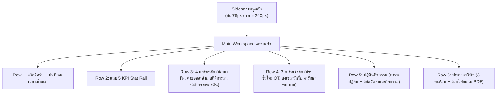

# CKACE HR — Owner Dashboard Design Specification

> **ระบบบริหารงานบุคคลและแดชบอร์ดผู้บริหาร (CKACE HR Portal)**  
> **Theme:** Light Blue Corporate Clean (สไตล์ SmartHR โทนสีฟ้าพาสเทลร่วมสมัย)  
> **Target Version:** 2026-10-29  
> **Author:** CKACE Design & Engineering Team

---

## 1. ข้อมูลทั่วไปและลิงก์เข้าชม (Overview & Live Links)

- **GitHub Pages (ดูหน้าเว็บจริงแบบออนไลน์):**  
  [https://panuphan-ck.github.io/ckace-hr-design-preview/owner-dashboard/](https://panuphan-ck.github.io/ckace-hr-design-preview/owner-dashboard/)
- **Direct Preview File:**  
  [https://panuphan-ck.github.io/ckace-hr-design-preview/owner-dashboard-preview.html](https://panuphan-ck.github.io/ckace-hr-design-preview/owner-dashboard-preview.html)
- **GitHub Repository (Preview):**  
  [https://github.com/Panuphan-CK/ckace-hr-design-preview](https://github.com/Panuphan-CK/ckace-hr-design-preview)
- **GitHub Repository (Source Code):**  
  [https://github.com/Panuphan-CK/ckace-hr](https://github.com/Panuphan-CK/ckace-hr) (Branch: `codex/ui-smarthr-lightblue`)
- **Local Server Development:**  
  `http://127.0.0.1:4186/owner-dashboard-preview.html#overview`

---

## 2. ปรัชญาการออกแบบ (Design Philosophy)

1. **Pure Thai Localization & Cohesive Wording:**  
   ภาษาไทยล้วน ไม่มีคำผสมภาษาอังกฤษที่ไม่จำเป็น (เช่น เปลี่ยน *Request OT* เป็น *เบิกล่วงเวลา*, *Overview* เป็น *แดชบอร์ด*)
2. **Harmonious Non-Distracting Colors (คุมโทน ไม่ฉูดฉาด):**  
   ใช้พื้นหลังสีฟ้าน้ำทะเลอ่อนเป็นมิตรกับสายตา (`#edf5fd`) การ์ดสีขาวบริสุทธิ์ (`#ffffff`) และเส้นขอบสีฟ้าจาง (`#dbe8f5`) แทนการใช้สีทึบหรือสีตัดกันรุนแรง
3. **Pixel-Perfect Vertical Alignment:**  
   การ์ดทุกใบในแถวเดียวกันมีจุดเริ่มต้นและจุดสิ้นสุดของชิ้นส่วน (Progress Tubes, Metric Boxes, Bottom Recent Claim) ตรงกันในระดับพิกเซลแนวนอน
4. **Data Density with Visual Hierarchy:**  
   จัดลำดับความสำคัญของข้อมูลด้วยขนาดตัวอักษรและความหนา เพื่อให้อ่านเข้าใจสถานะองค์กรได้ภายใน 3 วินาที

---

## 3. รหัสสีและ Design Tokens (Color Palette)

| บทบาทสี (Token) | รหัสสี (HEX) | การนำไปใช้งาน |
| :--- | :--- | :--- |
| **Canvas Background** | `#edf5fd` | พื้นหลังของหน้าจอทั้งหมด |
| **Card Surface** | `#ffffff` | พื้นหลังกล่องการ์ดทุกใบ |
| **Card Border** | `#dbe8f5` | เส้นขอบการ์ดปกติ |
| **Primary Corporate Blue** | `#1e70bf` | หัวเรื่องหลัก, ปุ่มหลัก, ไอคอนประจำระบบ |
| **Primary Soft** | `#edf5fc` | พื้นหลังป้ายกำกับ, หลอด Progress ส่วนสีอ่อน |
| **Primary Line** | `#c8e1fc` | ขอบป้ายกำกับสีฟ้า |
| **Ink / Black Text** | `#000000` | ข้อความสำคัญ, ตัวเลข Metric, ค่าเงิน |
| **Muted Text** | `#64748b` | ข้อความรอง, รหัสเอกสาร, คำอธิบายย่อย |
| **Semantic Success (Green)** | `#047857` / `#10b981` | ป้ายอนุมัติแล้ว, สถานะปกติ, เบิกค่ารักษาพยาบาล |
| **Semantic Warning (Amber)** | `#b45309` / `#f59e0b` | ป้ายรออนุมัติ, วันลาที่ต้องตรวจ |
| **Semantic Danger (Red)** | `#dc2626` / `#ef4444` | ป้ายยกเลิก (กรอบแดง), วันหยุดบริษัท |

---

## 4. โครงสร้างส่วนประกอบหน้าแดชบอร์ด (Component Architecture)

---

### รายละเอียดโครงสร้างในแต่ละแถว

### Row 1: ทักทายผู้บริหาร & บันทึกลงเวลาเข้า-ออก
- **ฝั่งซ้าย (Hero Welcome):**
  - หัวข้อขนาดใหญ่ `สวัสดีครับ` ฟอนต์เข้ม
  - ชื่อผู้ใช้งาน: `คุณภาณุพันธุ์ ใจดี` พร้อมตำแหน่ง `เจ้าหน้าที่ทรัพยากรบุคคล`
  - นาฬิกาดิจิทัลแสดงผลเวลาสดแบบ Real-time: `วันพุธที่ 28 ตุลาคม 2569 เวลา 21:37:35 น.`
- **ฝั่งขวา (ลงเวลาเข้า-ออกงาน):**
  - เวลาเข้า: `08:28:30 น.` พร้อมป้าย `✓ ตรงเวลา`
  - เวลาออก: `--:--:-- น.` พร้อมป้าย `ยังไม่ลงเวลา`

---

### Row 2: แถบสรุปดัชนีชี้วัด (Top 5 KPI Stat Rail)
ทุกการ์ดประกอบด้วยไอคอน SVG, หัวข้อสีดำ, ตัวเลขสถิติสีเฉพาะกลุ่ม, และป้าย % เปรียบเทียบกับวันก่อนหน้า:
1. **พนักงานทั้งหมด:** `103 คน` (สีน้ำเงิน `#1e70bf`)
2. **พร้อมทำงาน:** `86 คน` (สีเขียว `#0d8268`) | ป้าย `↑ 2.4%`
3. **ลาวันนี้:** `6 คน` (สีส้ม `#ea580c`) | ป้าย `↓ 1.2%`
4. **ลงเวลา:** `98.6%` (สีฟ้า `#0284c7`) | ป้าย `↑ 1.5%`
5. **รออนุมัติ:** `8 รายการ` (สีแอมเบอร์ `#b45309`) | ป้าย `↓ 12.5%`

---

### Row 3: 4 บอร์ดการทำงานหลัก (Main Deck Boards)
1. **สถานะทีม:** แสดงความพร้อมรวม `92%` พร้อมหลอดแจกแจงพนักงานปฏิบัติงานและลา
2. **คำขอของฉัน (3 รายการ):**
   - มีไอคอน SVG ขนาด 1 บรรทัด (22px) อยู่หน้าประเภทคำขอ
   - สถานะอยู่มุมขวาบนสุด:
     - `อนุมัติ` (กรอบสีเขียว)
     - `ยกเลิก` (กรอบสีแดง Outline)
     - `รออนุมัติ` (กรอบสีส้มแอมเบอร์)
   - บรรทัดที่ 2: รหัสคำขอและวันที่ ฟอนต์สีเทาขนาดเล็ก เช่น `LEV-0001 | 7 ต.ค. 2569`
   - บรรทัดที่ 3 & 4: วันที่ลา และเหตุผล ฟอนต์สีดำชัดเจน จัดกั้นหน้าตรงกัน
3. **สถิติการลา:** ป้ายหัวข้อ `รออนุมัติ 8` แสดงสถิติลารวม `6 คน` (คำว่า คน เป็นสีดำ)
4. **สถิติการลาของฉัน:** แสดงสิทธิ์ลาพักร้อน, ลาป่วย, ลากิจ โดยในหลอด Progress มีข้อความตัวเอียงหนาวิ่งตามปลายหลอด เช่น `ใช้ไป 3/15 (20%)` และ `คงเหลือ 12 วัน (80%)`

---

### Row 4: 3 การ์ดวิเคราะห์เชิงลึก (Insight Row)
*หลอด Progress และกล่องด้านล่างของการ์ดแถวนี้เริ่มต้นและสิ้นสุดที่ระดับความสูงเดียวกันเป๊ะ (`52px` และ `66px`)*
1. **สรุปชั่วโมง OT:**
   - ป้ายกำกับ: `สะสม 42.5 ชม.`
   - กราฟแท่งรายวัน 7 วัน สูงเต็มพื้นที่ (`height: 172px`) แสดงตัวเลขจำนวนชั่วโมงในแท่ง
2. **ลงเวลาวันนี้:**
   - เปอร์เซ็นต์ลงเวลาครบ `98.6%` จัดกึ่งกลาง
   - หลอด Progress ความกว้าง `83.5%` มีตัวเลข `86/103 คน` ในหลอด และ `83.5%` ตัวเอียง
   - 4 กล่องสถิติย่อย: ปกติ (86), มาสาย (9), ออกก่อน (4), ไม่ลงเวลา (4)
3. **สวัสดิการค่ารักษาพยาบาล:**
   - วงเงินต่อปี `฿10,000`, เบิกแล้ว `฿2,500`, คงเหลือ `฿7,500` (ฟอนต์สีดำทั้งหมด)
   - หลอด Progress สีเขียว แสดง `เบิกไป 25%` และ `คงเหลือ 75%`
   - กล่องรายการล่าสุด: ยอด `฿1,200` ฟอนต์สีเขียว พร้อมป้าย `อนุมัติแล้ว` ขนาดกรอบสูง `52px` เท่ากับกล่องด้านล่างของการ์ดลงเวลา

---

### Row 5: ปฎิทินกิจกรรม (Calendar Pro & Team Agenda)
- **ปฏิทินฝั่งซ้าย:**
  - หัวเดือน `< ตุลาคม 2569 >` จัดกึ่งกลางหน้าปฏิทิน
  - กรอบวัน จ. อ. พ. พฤ. ศ. ส. อา. เป็นกรอบสีพาสเทลตามวันประจำสัปดาห์
  - วันเสาร์และอาทิตย์มีกรอบสีเทาชัดเจน
  - วันหยุดประจำปี (เช่น 23 ต.ค. วันปิยมหาราช) มีป้ายวันหยุดสีแดง
  - ในเซลล์แสดงตัวย่อโปรไฟล์พนักงาน เช่น `จญ` (ลาพักร้อน), `อด` (OT), `🩺` (ตรวจสุขภาพ)
- **ลิสต์วันลาและกิจกรรมฝั่งขวา:**
  - กล่องวันที่ `ต.ค. 7-9` และกล่องไอคอนโปรไฟล์ `จญ` มีขนาดเท่ากันพอดีที่ **44px × 44px**
  - บรรทัดบน: `ชื่อพนักงาน | แผนก` พร้อมป้ายสถานะแบบ Outline ขอบคมชัด
  - บรรทัดล่าง: `ประเภทการลา/กิจกรรม และเหตุผล`

---

### Row 6: ประกาศบริษัท (Company Announcements)
- เลย์เอาต์ **3 คอลัมน์** เต็มหน้าจอ สอดรับกับ 3 การ์ดใน Row 4
- ป้ายวันที่จัดไว้ฝั่งซ้ายในสไตล์ `ck-badge-tag` เช่น `23 ต.ค. 2569`
- ป้ายหมวดหมู่จัดไว้ฝั่งขวาแบบ Outline กรอบชัดเจน (`วันหยุด`, `สวัสดิการ`, `กิจกรรม`)
- หัวข้อและเนื้อหาจัดกึ่งกลางกรอบ (`text-align: center`)
- มีปุ่มดาวน์โหลด **ไฟล์แนบเอกสาร (PDF)** พร้อมแสดงขนาดไฟล์จริง

---

## 5. มาตรฐานฟอนต์และ Typography

- **ฟอนต์หลัก:** `'Noto Sans Thai', 'Inter', -apple-system, BlinkMacSystemFont, sans-serif`
- **ตัวเลขอัตราส่วนและเวลา (Tabular Numbers):** ใช้ `font-variant-numeric: tabular-nums;` เพื่อให้นาฬิกาดิจิทัลเดินอย่างนิ่งเรียบ ไม่ขยับสั่นไหว
- **ข้อความในหลอด Progress:** ใช้ `font-style: italic; font-weight: 800;` เพื่อความคล่องตัวและทันสมัย

---

## 6. แนวทางการดูแลและปรับปรุงต่อยอด (Maintenance & Next Steps)

1. ไฟล์แม่แบบอยู่ที่: `docs/design/ui-smarthr-lightblue-20261026/owner-dashboard-preview.html`
2. ไฟล์สำหรับ GitHub Pages อยู่ที่โฟลเดอร์: `owner-dashboard/index.html` ของ Repository `Panuphan-CK/ckace-hr-design-preview`
3. ทุกครั้งที่มีการอัปเดตไฟล์แม่แบบ สามารถคัดลอกไฟล์ไปยังโฟลเดอร์ `owner-dashboard/index.html` และสั่ง `git commit & push` ขึ้น branch `main` ระบบ GitHub Actions จะดีพลอยหน้าเว็บใหม่อัตโนมัติทันที
