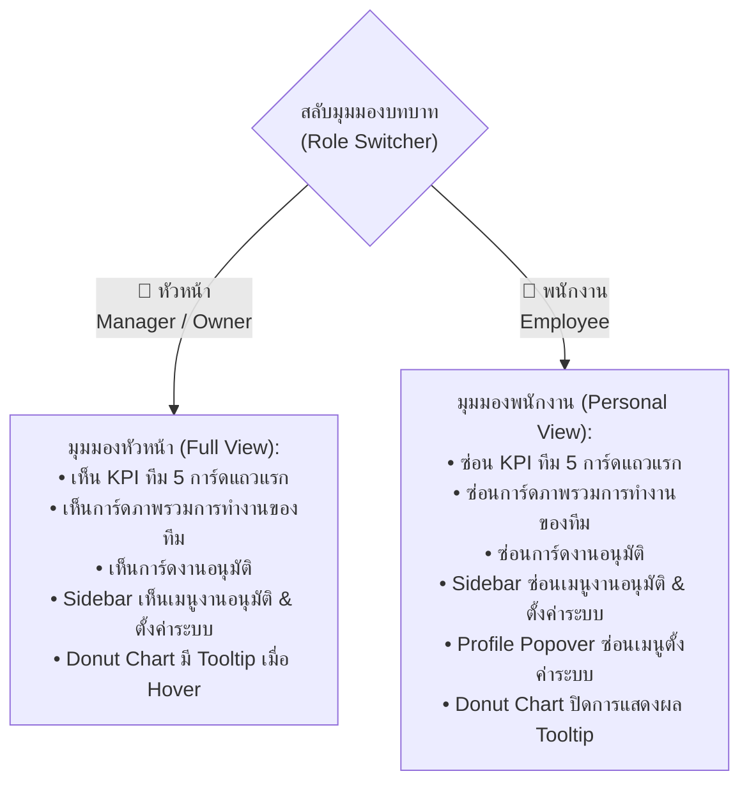

# CKACE HR — Dashboard Design Specification & Standard Lock (Design.md)

> **สถานะเอกสาร:** 🔒 **ALL PAGES LOCKED EXCEPT SETTINGS (`#settings`) — FINAL APPROVED (ล็อกทุกหน้ายกเว้นตั้งค่าระบบ ห้ามแก้ไข)**  
> **วันที่มีผลบังคับใช้:** 14 พฤศจิกายน 2569 (2026-11-14) · **Tag ล็อก:** `lock-all-except-settings-20261114`  
> **ผลิตภัณฑ์:** CKACE HR Enterprise Portal (ระบบบริหารงานบุคคลและแดชบอร์ดผู้บริหาร/พนักงาน)  
> **สไตล์หลัก:** SmartHR Light-Blue Corporate Clean (โทนสีฟ้าพาสเทลร่วมสมัย สะอาด สบายตา คมชัด เป็นมืออาชีพ)  
> **ข้อตกลงการล็อก:** หน้าแดชบอร์ด (`#overview`), ลางาน (`#leave`), เบิก OT (`#ot`), ลงเวลาและแก้ไขเวลา (`#attendance`), สวัสดิการ OPD (`#benefits`), ระบบงานอนุมัติ (`#approvals`), รายงานและสถิติ (`#reports`) และโปรไฟล์ (`#profile`) **ล็อกการออกแบบเสร็จสมบูรณ์ทุกหน้า ยกเว้นหน้าตั้งค่าระบบ (`#settings`)** ห้ามแก้ไข Layout, โครงสร้างการ์ด, สี KPI, ตัวกรอง, ตารางประวัติ และ Modal จนกว่าจะได้รับคำสั่งปลดล็อกจากผู้ใช้  
> **ไฟล์ต้นแบบหลัก (Single Source of Truth):**  
> [`docs/design/ui-smarthr-lightblue-20261026/owner-dashboard-preview.html`](./docs/design/ui-smarthr-lightblue-20261026/owner-dashboard-preview.html)

---

## 1. ลิงก์และช่องทางการเข้าชม (Live Links & Environments)

| สภาพแวดล้อม | URL / เส้นทางไฟล์ | รายละเอียด |
| :--- | :--- | :--- |
| **Local Preview (Browser)** | `file:///D:/CKACE_HR.worktrees/ux-ui/docs/design/ui-smarthr-lightblue-20261026/owner-dashboard-preview.html#overview` | เปิดดูในเครื่องได้ทันที รองรับ 100% Offline (มี Base64 Fallback) |
| **GitHub Repository** | `https://github.com/Panuphan-CK/ckace-hr` | สาขาหลัก: `codex/ui-smarthr-lightblue` |
| **GitHub Pages Preview** | `https://panuphan-ck.github.io/ckace-hr-design-preview/owner-dashboard-preview.html` | ตัวอย่าง Live Demo ออนไลน์ |

---

## 2. อัตลักษณ์องค์กรและโลโก้ (Corporate Brand Identity Lock)

- **โลโก้ประจำระบบ:** โลโก้ทางการ **`CK.%ACE ACCOUNTING`**
- **สัญลักษณ์สี:** น้ำเงินเข้มคอร์ปอเรต (`#0b3b68` / `#1b4580`) ตัดกับสีทองหรูหรา (`#d4a34b`)
- **การจัดวางใน Sidebar:**
  - **ขนาดก่อนย่อ (Expanded):** `max-width: 155px; max-height: 46px;` วางมุมซ้ายบนอย่างพอดีกับความกว้าง Sidebar 180px ไม่เหลือขอบขาวส่วนเกิน
  - **ขนาดเมื่อย่อ (Collapsed):** `max-width: 52px; max-height: 26px; margin: 0 auto;`
  - **Fallback Redundancy:** มีการฝัง Base64 Data URI ไว้ใน `onerror` เพื่อให้แสดงผลได้ 100% แม้เปิดไฟล์ผ่านโปรโตคอล `file:///` โดยไม่มีเว็บเซิร์ฟเวอร์

---

## 3. สถาปัตยกรรมเลย์เอาต์และระบบกริด (Layout & Responsive Architecture)

### 3.1 การจัดสัดส่วน Sidebar & Workspace
- **ความกว้าง Sidebar ก่อนย่อ (Expanded):** ล็อกไว้ที่ **`180px`**  
  *(Padding ซ้าย-ขวา ข้างละ 10px ทำให้พื้นที่ด้านในเท่ากับ 160px พอดีกับความกว้างของโลโก้ 125-155px อย่างลงตัว)*
- **ความกว้าง Sidebar เมื่อย่อ (Collapsed):** ล็อกไว้ที่ **`76px`**
- **ความลื่นไหลของการย่อ-ขยาย:** ใช้ CSS Transition `grid-template-columns 0.25s cubic-bezier(0.4, 0, 0.2, 1);`
- **ปุ่มแถวล่างของ Sidebar (กระดิ่ง / เปลี่ยนแอป / รูปโปรไฟล์):**
  - ล็อกขนาดปุ่มเป็น `36px × 36px` เท่ากันทุกปุ่ม
  - ใช้ `display: flex !important; justify-content: space-between !important; flex-wrap: nowrap !important;`
  - ใช้ `flex-shrink: 0 !important;` เพื่อป้องกันการบีบอัด
  - **Zero Collision Guarantee:** ผลรวมความกว้างของปุ่ม $36 \times 3 = 108\text{px}$ จากพื้นที่ใช้งาน $160\text{px}$ เหลือช่องว่างระยะห่าง $52\text{px}$ (เฉลี่ยข้างละ 26px) ป้องกันการซ้อนทับกันอย่างเด็ดขาด 100%

### 3.2 ความยืดหยุ่นเต็มหน้าจอ (Fluid Full-Width & Responsiveness)
- เลิกใช้ขอบเขตจำกัด `max-width: 1540px` บนแดชบอร์ดหลัก โดยเปลี่ยนเป็น `width: 100%; max-width: none;` เพื่อให้เนื้อหากระจายตัวเต็มพื้นที่หน้าจอบนจอกว้าง (Ultrawide)
- รองรับขนาดหน้าจอทุกระดับ:
  - **Desktop (> 850px):** เลย์เอาต์เต็มรูปแบบ 5-6 คอลัมน์ตามโครงสร้างหลัก
  - **Tablet (<= 850px):** ปรับการ์ดหลักเป็น 2 คอลัมน์ และจัดระยะขอบ padding ให้กระชับ
  - **Mobile (<= 620px):** ปรับเป็น 1 คอลัมน์เดี่ยว ย่อแถบนำทางอัตโนมัติ

---

## 4. โครงสร้าง 2 มุมมองการใช้งาน (Dual-Role View Lock)

ระบบได้ออกแบบ **Role Switcher Toolbar** (สำหรับใช้ทดสอบการออกแบบ) อยู่มุมบนขวาของหน้าแดชบอร์ด โดยมีกฎการแสดงผลที่ล็อกไว้ดังนี้:

### สรุปกฎการแสดงผลสำหรับบทบาทพนักงาน (Employee View Rules):
1. **ซ่อนการ์ดดัชนีชี้วัดทีม (5 Team KPI Cards):** แถวแรกที่สรุปยอดทั้งองค์กรจะไม่ปรากฏแก่พนักงานทั่วไป
2. **ซ่อนการ์ด "ภาพรวมการทำงานของทีม":** ไม่เปิดเผยข้อมูลอัตรากำลังและเปอร์เซ็นต์ทีม
3. **ซ่อนการ์ด "งานอนุมัติ":** ไม่แสดงรายการรออนุมัติของผู้อื่น
4. **ซ่อนเมนูใน Sidebar:**
   - ซ่อนเมนู `งานอนุมัติ` (`#nav-approvals-link`)
   - ซ่อนหมวดหมู่ `ADMINISTRATION` (`#nav-admin-label`) และเมนู `ตั้งค่าระบบ [Codex]` (`#nav-settings-link`)
5. **ซ่อนใน Popover บัญชีผู้ใช้งาน:** ซ่อนปุ่มลิงก์ `ตั้งค่าระบบ` (`#pf-settings-link`)
6. **ปิดการทำงาน Tooltip ใน Donut Chart:** เมื่อพนักงานนำเมาส์ไปชี้ที่สัดส่วนการลา จะไม่ปรากฏกล่อง Tooltip แสดงรายชื่อพนักงานที่ลา (To-list) เพื่อรักษาความเป็นส่วนตัวของเพื่อนร่วมงาน

---

## 5. ลำดับส่วนประกอบหน้าแดชบอร์ด (Component Hierarchy Lock)

### Row 1: ทักทายผู้ใช้งาน (Hero) & การ์ดลงเวลาเข้า-ออกงาน
- **ฝั่งซ้าย (Hero Welcome):**
  - ข้อความหัวเรื่อง: `สวัสดีครับ` ขนาดใหญ่ หนา เด่นชัด
  - ชื่อผู้ใช้งาน: `คุณภาณุพันธุ์ ใจดี` พร้อมป้ายตำแหน่ง `เจ้าหน้าที่ทรัพยากรบุคคล`
  - นาฬิกาดิจิทัล Real-time: แสดงวัน เดือน ปี พ.ศ. และเวลาเดินวินาทีสดแบบ Tabular Numbers ไม่สั่นไหว
- **ฝั่งขวา (บันทึกลงเวลา):**
  - ไม่แสดงข้อความหัวเรื่องซ้ำซ้อน
  - แสดงเวลาเข้างานจริง: `08:28:30 น.` พร้อมป้ายสถานะสีเขียว `✓ ตรงเวลา` จัดชิดขวา
  - แสดงเวลาออกงาน: `--:--:-- น.` พร้อมป้าย `ยังไม่ลงเวลา`

### Row 2: ดัชนีชี้วัดภาพรวมทีม (5 Team KPI Stat Cards) *(แสดงเฉพาะหัวหน้า)*
ประกอบด้วย 5 การ์ดไอคอนสีเฉพาะกลุ่ม พร้อมเปอร์เซ็นต์เทียบวันก่อนหน้า:
1. **พนักงานทั้งหมด:** `103 คน` (สีน้ำเงินคอร์ปอเรต `#1e70bf`)
2. **พร้อมทำงาน:** `86 คน` (สีเขียว `#0d8268` | ป้าย `↑ 2.4%`)
3. **ลาวันนี้:** `6 คน` (สีส้ม `#ea580c` | ป้าย `↓ 1.2%`)
4. **ลงเวลา:** `98.6%` (สีฟ้า `#0284c7` | ป้าย `↑ 1.5%`)
5. **รออนุมัติ:** `8 รายการ` (สีส้มแอมเบอร์ `#b45309` | ป้าย `↓ 12.5%`)

### Row 2.5: ดัชนีชี้วัดส่วนบุคคล (6 Personal KPI Stat Cards) *(ตัวชี้วัดของฉัน)*
- หัวข้อกลุ่ม: `ตัวชี้วัดของฉัน` ใช้ฟอนต์สีดำเข้ม (`#1e293b`) สะอาดตา นำข้อความภาษาอังกฤษและปีออก
- ระยะห่าง (Margin): ลดระยะห่างให้กระชับสมดุลรับกับกรอบถัดไป
- ประกอบด้วย 6 การ์ดข้อมูลส่วนบุคคล:
  1. **ลาพักร้อน:** ใช้ไป `3 วัน` / คงเหลือ `12 วัน`
  2. **ลาป่วย:** ใช้ไป `1 วัน` / คงเหลือ `29 วัน`
  3. **ลากิจ:** ใช้ไป `0 วัน` / คงเหลือ `3 วัน`
  4. **ชั่วโมง OT:** `42.5 ชม.` (ป้าย `เดือนนี้`)
  5. **การลงเวลา:** `18/19 วัน` (ป้าย `ตรงเวลา 95%`)
  6. **เบิกค่ารักษา:** เบิกแล้ว `฿2,500` / คงเหลือ `฿7,500`

### Row 3: 4 บอร์ดการทำงานหลัก (Main Deck Boards)
1. **ภาพรวมการทำงานของทีม:** แสดงอัตราความพร้อม `92%` พร้อมหลอดแจกแจงสถานะ *(ซ่อนในมุมมองพนักงาน)*
2. **คำขอของฉัน (My Requests):**
   - แสดง 3 รายการคำขอล่าสุดพร้อมไอคอนชัดเจน
   - ป้ายสถานะอยู่มุมขวาบน: `อนุมัติ` (เขียว), `ยกเลิก` (แดง Outline), `รออนุมัติ` (ส้มแอมเบอร์)
   - ข้อมูลคำขอ: รหัสเอกสาร วันที่ขอ วันที่ลา และเหตุผล จัดขอบตรงกันอ่านง่าย
3. **สถิติการลา (Leave Statistics):**
   - แสดงยอดลารวม `6 คน` (คำว่า "คน" เป็นสีดำมาตรฐาน)
   - กราฟ Donut Chart แยกประเภทการลาชัดเจน
4. **สถิติการลาของฉัน (My Leave Quota):**
   - แสดงหลอดสิทธิ์การลา 3 ประเภทหลัก
   - ข้อความตัวเอียงหนาวิ่งตามปลายหลอด เช่น `ใช้ไป 3/15 (20%)` และ `คงเหลือ 12 วัน (80%)`

### Row 4: 3 การ์ดการวิเคราะห์เชิงลึก (Deep Insight Row)
*หลอด Progress และกล่องสรุปด้านล่างของการ์ดแถวนี้ล็อกระดับความสูงและตำแหน่งเริ่มต้น-สิ้นสุดตรงกันในระดับพิกเซล:*
1. **สรุปชั่วโมง OT (OT Analytics):**
   - สถิติสะสม `42.5 ชม.`
   - กราฟแท่ง 7 วัน สัดส่วนสูงเต็มพื้นที่ (`height: 172px`) แสดงตัวเลขชั่วโมงในแท่ง
2. **ลงเวลาวันนี้ (Attendance Today):**
   - อัตราลงเวลา `98.6%`
   - หลอดแสดงอัตราส่วน `86/103 คน` (`83.5%`)
   - 4 กล่องสถิติย่อย: ปกติ (86), มาสาย (9), ออกก่อน (4), ไม่ลงเวลา (4)
3. **สวัสดิการค่ารักษาพยาบาล (Medical Benefits):**
   - สรุปวงเงินต่อปี `฿10,000`, เบิกแล้ว `฿2,500`, คงเหลือ `฿7,500` (ตัวเลขสีดำชัดเจน)
   - หลอดแสดงสถานะสีเขียว: เบิกไป 25% | คงเหลือ 75%
   - กล่องประวัติล่าสุด: ยอด `฿1,200` ฟอนต์สีเขียวพร้อมป้าย `อนุมัติแล้ว` ขนาดสูงเท่ากับกล่องด้านล่างของการ์ดลงเวลาพอดีเป๊ะ (`52px`)

### Row 5: ปฏิทินและวาระงานองค์กร (Calendar & Team Agenda)
- **ปฏิทิน (ฝั่งซ้าย):**
  - ส่วนหัวเดือน `< ตุลาคม 2569 >` จัดกึ่งกลาง
  - วันในสัปดาห์ใช้สีกรอบพาสเทลตามวัน ส่วนวันเสาร์-อาทิตย์มีกรอบสีเทาชัดเจน
  - วันหยุดประจำปีมีป้ายสีแดงเด่นชัด (เช่น วันปิยมหาราช 23 ต.ค.)
  - ในเซลล์วันแสดงไอคอนและอักษรย่อโปรไฟล์พนักงาน
- **ลิสต์วันลาและกิจกรรม (ฝั่งขวา):**
  - กล่องวันที่ `ต.ค. 7-9` และรูปโปรไฟล์มีขนาดเท่ากันสมบูรณ์ที่ **`44px × 44px`**
  - แสดงชื่อพนักงาน, แผนก, ประเภทการลา, และป้ายสถานะ

### Row 6: ประกาศบริษัท (Company Announcements)
- เลย์เอาต์ **3 คอลัมน์** เต็มหน้าจอ
- วันที่จัดวางในสไตล์ป้ายแท็กด้านซ้าย (`23 ต.ค. 2569`) หมวดหมู่อยู่ด้านขวา
- หัวข้อและเนื้อหาจัดกึ่งกลางกรอบ
- มีปุ่มดาวน์โหลดไฟล์แนบ PDF พร้อมบอกขนาดไฟล์จริง (เช่น `ประกาศวันหยุด2569.pdf (1.2 MB)`)

---

## 6. ระบบกรองช่วงเวลาและขอบเขตข้อมูลสำหรับหัวหน้า (Period Filter & Manager Scope Standard)

แดชบอร์ดหลักติดตั้งปุ่มตัวกรองอเนกประสงค์บนการ์ดบันทึกเวลาทำงาน (`#ov-filter-btn`) พร้อมหน้าต่างตัวเลือกแบบ Popover มาตรฐาน:

### 6.1 ตัวกรองช่วงเวลา (Time Period Filter)
- **ตัวเลือกหลัก:**
  - `ทั้งปี`: แสดงข้อมูลสะสมตลอดปีปฏิทินที่เลือก
  - `เดือนนี้`: กรองข้อมูลเฉพาะเดือนปัจจุบัน
  - `เดือนก่อน`: กรองข้อมูลย้อนหลัง 1 เดือน
  - `ช่วงเวลา` (ปุ่มไอคอนปฏิทิน): เมื่อคลิกจะขยายแผงตัวเลือกแบบกำหนดเอง (Custom Period Picker)
- **แผงกำหนดช่วงเวลา (Custom Period Picker - รูปแบบปี 2569 สม่ำเสมอทุกจุด):**
  - มีดรอปดาวน์สลับโหมด 2 รูปแบบตามสเปก UI:
    1. **เลือกเดือน (Month Grid):** แสดงตัวเลื่อนปีในรูปแบบ พ.ศ. `< 2569 >` พร้อมตาราง 12 เดือน (ม.ค. - ธ.ค.) ในรูปแบบปุ่มกริด 4 คอลัมน์
    2. **กำหนดช่วงวันที่ (Calendar Date Range Grid):** แสดงปฏิทินรายเดือนในรูปแบบ พ.ศ. `< พฤศจิกายน 2569 >` พร้อมแถววันภาษาไทย `จ. อ. พ. พฤ. ศ. ส. อา.` และตารางวันที่ 1-30 รองรับการคลิกเลือกช่วงวันที่ (Range Selection: วันเริ่มต้น - วันสิ้นสุด) พร้อมไฮไลต์ช่วงวันที่เลือกชัดเจน
- **การแสดงผลบนปุ่มตัวกรอง:** แสดงเฉพาะข้อความ ปี หรือ ช่วงเวลา เท่านั้น (เช่น `ปี 2569`, `เดือนนี้`, `เดือนก่อน`, `ต.ค. 2569`, `5–15 พ.ย. 2569`) ไม่นำข้อความขอบเขตข้อมูลมาต่อท้าย เพื่อป้องกันปุ่มกว้างเกินจนล้นกรอบด้านบน

### 6.2 ขอบเขตข้อมูลระดับหัวหน้า (Manager Scope Selector)
ยกเลิกคำว่า "เรียงตาม" เดิม และแทนที่ด้วย "ขอบเขตข้อมูล" สำหรับระดับหัวหน้างานและผู้บริหาร:
1. **การควบคุมการแสดงผล (Role Visibility):** ส่วนขอบเขตข้อมูลนี้จะ **แสดงผลเฉพาะเมื่อเลือก "มุมมองบทบาท" เป็นหัวหน้า (👔 หัวหน้า (Manager / Owner)) เท่านั้น** หากเป็นมุมมองพนักงานทั่วไปจะถูกซ่อนอัตโนมัติ
2. **ตัวเลือก 3 ระดับ:**
   - **ภาพรวม (All Organization):** สรุปยอดรวมพนักงานทั้งองค์กร (103 คน)
   - **ตามแผนก (Department Scope):** ดรอปดาวน์เลือกเจาะจงเฉพาะแผนก เช่น ฝ่ายบัญชีและการเงิน (45 คน), ฝ่ายตรวจสอบบัญชี (38 คน), ฝ่ายทรัพยากรบุคคล (20 คน)
   - **เจาะจงพนักงาน (Individual Employee Scope):** ดรอปดาวน์เลือกเจาะจงรายชื่อพนักงานรายบุคคล
3. **Interactive Feedback:** เมื่อกด "นำไปใช้" ระบบจะอัปเดตสถิติและตัวเลข KPI บนแดชบอร์ด (พนักงานทั้งหมด, พร้อมทำงาน, ลาวันนี้, การลงเวลา, รออนุมัติ) ให้สอดคล้องกับขอบเขตที่เลือกจริงแบบ Dynamic

---

## 7. มาตรฐานการตอบสนองเมื่อเมาส์ชี้ (Hover State White Background Lock)

เพื่อความเป็นระเบียบ สะอาดตา และความสม่ำเสมอของ UI ทั่วทั้งแดชบอร์ด ทุกกรอบการ์ด ทุกกล่องสถิติ และทุกเซลล์กิจกรรม เมื่อนำเมาส์ไปชี้ (Hover) จะต้องเปลี่ยนพื้นหลังเป็น **สีขาวบริสุทธิ์ (`background: #ffffff !important;`)** เสมอ:
- `.ck-card:hover` (การ์ดหลักทุกใบ)
- `.ck-att-tile:hover` (กรอบเวลาเข้า-เวลาออก)
- `.ck-stat-item:hover` (การ์ด KPI 5 ใบแถวบน)
- `.ck-stat-item-sub:hover` (การ์ด KPI ย่อย 6 ใบแถวล่าง)
- `.ck-sub-board:hover` (กรอบสถานะทีม สถิติการลา และลงเวลา)
- `.ck-act-item:hover` (การ์ดคำขอของฉัน)
- `.ck-appr-item:hover` (การ์ดงานอนุมัติ)
- `.ck-pers-card:hover` (การ์ดสถิติวันลาส่วนบุคคล)
- `.ck-att-sub:hover` / `.ck-med-sub:hover` / `.ck-med-recent:hover` (กล่องย่อยลงเวลาและสวัสดิการ)
- `.ck-agenda-item:hover` (รายการวันลาและกิจกรรม)
- `.ck-cal-c:hover` (เซลล์วันที่ในปฏิทิน)
- `.ck-news-box:hover` (กล่องข่าวสารและประกาศ)

---

## 8. รหัสสีและ Design Tokens (Color Palette)

| บทบาทสี (Design Token) | ค่าสี (HEX) | วัตถุประสงค์ในการใช้งาน |
| :--- | :--- | :--- |
| `--c-canvas` | `#edf5fd` | พื้นหลังของระบบทั้งหมด (ฟ้าอ่อนพาสเทล) |
| `--c-card` | `#ffffff` | พื้นผิวการ์ดทุกใบ |
| `--c-border` | `#dbe8f5` | เส้นขอบกล่องการ์ดและเส้นคั่นปกติ |
| `--c-brand` | `#1e70bf` | หัวเรื่องหลัก, ปุ่มหลัก, ไอคอนไฮไลต์ |
| `--c-brand-dark` | `#0b3b68` | ตัวอักษรโลโก้, สีเข้มของแบรนด์ |
| `--c-gold` | `#d4a34b` | สีทองของโลโก้ CK.%ACE |
| `--c-text-primary` | `#000000` / `#1e293b` | ข้อความสำคัญ, ตัวเลข Metric, ยอดเงิน |
| `--c-text-muted` | `#64748b` | ข้อความรอง, รหัสเอกสาร, คำอธิบาย |
| `--c-success` | `#047857` / `#10b981` | ป้ายอนุมัติแล้ว, เบิกค่ารักษา, สถานะปกติ |
| `--c-warning` | `#b45309` / `#f59e0b` | ป้ายรออนุมัติ, วันลาที่ต้องตรวจสอบ |
| `--c-danger` | `#dc2626` / `#ef4444` | ป้ายยกเลิก (กรอบแดง Outline), วันหยุดราชการ |

---

## 9. ข้อกำหนดและมาตรฐานทางเทคนิค (Technical Enforcement)

1. **ห้ามปรับลดทอนฟังก์ชันที่ล็อกไว้ (Strict Lock):**
   - ความกว้างของ Sidebar ที่ `180px` และความสูงโลโก้ที่ `46px` ถือเป็นค่ามาตรฐาน ห้ามขยายหรือลดทอนโดยไม่มีมติการออกแบบใหม่
   - ปุ่มล่างสุด 3 ชิ้นของ Sidebar ต้องคงคุณสมบัติ `flex-shrink: 0`, `nowrap`, และ `justify-content: space-between` เสมอ เพื่อป้องกันปัญหาไอคอนซ้อนทับกัน
   - ฟังก์ชันสลับมุมมอง 2 บทบาท (หัวหน้า vs พนักงาน) ต้องรักษาคลาส `.role-employee` และการซ่อนข้อมูลตามที่ระบุไว้ในข้อ 4
2. **ภาษาไทยล้วน (Pure Thai UI):** ทุกปุ่ม เมนู และสถานะ ต้องใช้ภาษาไทยที่กระชับ สละสลวย ถูกต้องตามบริบทงานบุคคลไทย
3. **การนำไปต่อยอด (Implementation Ready):** โค้ดใน `owner-dashboard-preview.html` ได้รับการจัดระเบียบและเขียน CSS Modules / Component Structure ไว้อย่างชัดเจน พร้อมสำหรับการแปลงเป็น React / Next.js Components ในโฟลเดอร์ `apps/web` ต่อไป

---

## 10. ข้อกำหนดมาตรฐานระบบลางาน (Leave System Standard Lock — #leave)

หน้าระบบลางาน (`#leave`) ได้รับการออกแบบ ตรวจสอบ และล็อกมาตรฐานสมบูรณ์ตามแนวคิด SmartHR Light-Blue ดังนี้:

### 10.1 สถิติวันลาส่วนบุคคล (Leave KPI Cards - 4 การ์ด แถวบน)
- **ระบบกริด:** 4 คอลัมน์ `repeat(4, minmax(0, 1fr))` และปรับเป็น 2 คอลัมน์บนแท็บเล็ต, 1 คอลัมน์บนมือถือ
- **ขนาดไอคอนมาตรฐาน:** ล็อกขนาดกรอบไอคอนเป็น `40px × 40px` (SVG ขนาด `22px × 22px`) รัศมีความโค้งมน `border-radius: 11px;`
- **ชุดไอคอนประจำประเภทวันลา:**
  - **ลาพักร้อน:** ไอคอนเครื่องบิน (Airplane `#1e70bf`, พื้นหลัง `#e0f2fe`)
  - **ลาป่วย:** ไอคอนหัวใจพยาบาลมีเครื่องหมายบวกสีเขียวตรงกลาง (Green Medical Cross Heart `#16a34a`, พื้นหลัง `#dcfce7`)
  - **ลากิจ:** ไอคอนกระเป๋าเดินทาง (Luggage `#d97706`, พื้นหลัง `#fef3c7`)
  - **สรุปภาพรวม:** ไอคอนปฏิทิน/ประวัติการลา (`#2563eb`, พื้นหลัง `#dbeafe`)
- **การจัดวางและขนาดตัวเลข Metric:**
  - ตัวเลข `ใช้ X.XX วัน / เหลือ Y.YY วัน` จัดกึ่งกลาง (`text-align: center`)
  - ขนาดตัวอักษรล็อกไว้ที่ `20px` (และ `17px` บนหน้าจอแล็ปท็อป $\le 1366\text{px}$) `font-weight: 800;`
  - สีตัวเลขกลมกลืนตามธีมของการ์ดแต่ละใบ

### 10.2 ฟอร์มยื่นคำขอลางาน และสายการอนุมัติ 3 ระดับ (Leave Request Form & Approval Chain)
- **ระบบกริด 2 คอลัมน์:** `.ck-leave-form-cols` สัดส่วน `minmax(0, 1.15fr) minmax(0, 1fr)` ระยะห่าง `22px`
- **คอลัมน์ซ้าย (ข้อมูลคำขอ):**
  - เลือกประเภทการลา (ลาพักร้อน, ลาป่วย, ลากิจ, ฯลฯ)
  - รูปแบบการลา (เต็มวัน, ครึ่งวันเช้า, ครึ่งวันบ่าย, รายชั่วโมง) พร้อมช่องระบุช่วงเวลาที่แสดงต่อเนื่องอย่างลงตัว
  - ตัวเลือกช่วงวันที่ลา (วันเริ่มต้น - วันสิ้นสุด) พร้อม Popover ปฏิทินภาษาไทย
  - เหตุผลการลา และ กล่องอัปโหลดเอกสารแนบ
- **คอลัมน์ขวา (สายการอนุมัติ & สรุปสิทธิ์):**
  - **กล่องสายการอนุมัติ (`.ck-auto-chain-box`):** กรอบใหญ่สีขาวสะอาดตา `background: #ffffff !important;` ขอบ `1.5px solid #d4e5f5;`
  - **การ์ดผู้อนุมัติทั้ง 3 คน (`.ck-chain-node`):**
    - พื้นหลังฟ้าอ่อน `#f0f7fe` และเมื่อนำเมาส์ไปชี้จะเปลี่ยนเป็น **สีขาวบริสุทธิ์ (`background: #ffffff !important;`)** ขอบฟ้า `#93c5fd` ยกตัวลอยขึ้นเล็กน้อย (`transform: translateY(-2px);`)
    - **แถวบน:** จัดวางระดับเดียวกัน (`justify-content: space-between; align-items: center;`)
      - ฝั่งซ้าย: ไอคอนโปรไฟล์อักษรย่อทรงกลม 34px (`สม`, `ศว`, `จอ`) ตามสีประจำตำแหน่ง
      - ฝั่งขวา (มุมขวาของกรอบ): **ป้ายลำดับสีฟ้า** (`ลำดับที่ 1`, `ลำดับที่ 2`, `ลำดับที่ 3`) สไตล์เดียวกับป้ายสิทธิ์ 15.00 วัน (`background: #eff6ff; color: #1e70bf; border: 1px solid #bfdbfe; border-radius: 6px; padding: 2px 8px; font-size: 11px; font-weight: 700;`)
    - **แถวล่าง:** ชื่อ-นามสกุล และตำแหน่งผู้อนุมัติแสดงเต็มความกว้างด้านล่าง
  - **กล่องสรุปสิทธิ์วันลาแบบ Real-time (`.ck-quota-live-box`):** คำนวณวันลาคงเหลือและแสดงสถานะโควตาตามประเภทที่เลือกทันที
  - **ปุ่มส่งคำขอ:** ปุ่มสีฟ้าเด่นชัดเต็มความกว้างพร้อมไอคอนจรวดกระดาษ

### 10.3 ตารางประวัติคำขอลางาน (Leave History Table)
- **การจัดกึ่งกลางคอลัมน์:** ข้อมูลทุกคอลัมน์จัดกึ่งกลาง (`text-align: center`) เพื่อความสมดุลสายตา
- **คอลัมน์รหัสคำขอและวันที่:** แสดงเป็น 2 บรรทัด (บรรทัดแรก: รหัสคำขอ เช่น `LEV-2569-004`, บรรทัดสอง: วันที่ยื่นคำขอ เช่น `30/10/2569` สีเทา)
- **คอลัมน์พนักงาน:** แสดงชื่อพนักงาน และย้ายหน่วยงาน/ฝ่ายไปไว้บรรทัดสองใต้ชื่อพนักงาน
- **คอลัมน์ประเภทการลา:** แสดงเฉพาะชื่อประเภทการลาสั้นกระชับ (ตัดคำว่าเต็มวัน/รายชั่วโมงออก)
- **คอลัมน์ช่วงวันที่ลา:** แสดงวันที่เริ่ม - สิ้นสุด รองรับการตัดบรรทัด (WIP Text 2 บรรทัด) กรณีลาหลายวัน
- **คอลัมน์เหตุผล:** รองรับ WIP Text ตัดบรรทัดและจัดกึ่งกลางไม่ล้นตาราง
- **คอลัมน์สถานะ (Status Badges):**
  - อนุมัติครบ: แสดงแค่ `✓ อนุมัติ` สีเขียว (`.pg-badge-success`)
  - รออนุมัติ: แสดง `รออนุมัติ (2/3)` สีส้มอำพัน (`.pg-badge-warning`)
  - ไม่อนุมัติ: แสดง `✕ ไม่อนุมัติ (2/3)` สีแดงอ่อน (`.pg-badge-danger`)
- **คอลัมน์การจัดการ (Actions):** 3 ปุ่มไอคอนแบบ `flex-wrap: nowrap` (ดูรายละเอียด, แก้ไข, ยกเลิก) โดยคงปุ่มกากบาทยกเลิกไม่ให้ตกบรรทัดหรือถูกตัดขอบ

### 10.4 หน้าต่างป็อปอัปรายละเอียดคำขอลา (Leave Detail Modal Lock — #ck-detail-modal)
- **เลย์เอาต์หน้าเดียว 2 คอลัมน์ (Single-Page Compact, No Scrollbar):**
  - ล็อกความกว้าง `max-width: 880px`, ความสูง `max-height: 90vh`, ปิดสโครลบาร์แนวตั้ง (`overflow: hidden`)
  - ตัดการ์ดสรุปการลาประจำปีด้านขวาออกทั้งหมด เพื่อเน้นเนื้อหาคำขอและขั้นตอนการอนุมัติที่ชัดเจน
- **คอลัมน์ซ้าย (ข้อมูลคำขอลา):**
  - ส่วนหัวโปรไฟล์ผู้ขอลาและป้ายสถานะคำขอ
  - แถบด้านบน: รหัสคำขอ (`LEV-2569-004`) และ วันที่ยื่นคำขอ (`30/10/2569`) แบบไม่มีกรอบสีขาว
  - ข้อมูล 4 ช่อง: ประเภทการลา (พร้อมไอคอนสีประจำประเภท), รูปแบบการลา (เช่น `เต็มวัน`), ช่วงวันที่ลา, จำนวนวันลา (ตัดข้อความวงเล็บซ้ำซ้อนออก)
  - **เงื่อนไขช่วงวันที่ลา:** กรณีครึ่งวัน หรือ รายชั่วโมง (หรือวันเดียว) ให้แสดงช่วงวันที่ลาเป็น **วันเดียว**
  - กล่องเหตุผลการลา และ เอกสารแนบแบบ Compact Single-line แถบเดียวพร้อมปุ่มเปิดไฟล์
- **คอลัมน์ขวา (สายการอนุมัติ 3 ระดับ):**
  - หัวข้อ "สายการอนุมัติ" พร้อมป้ายระบุ "3 ระดับ"
  - Stepper วงกลมแนวนอน 1 - 2 - 3 พร้อมสีตามสถานะจริง
  - การ์ดผู้อนุมัติทั้ง 3 คน แสดงป้ายลำดับวงกลม, ชื่อผู้อนุมัติ, ป้ายสถานะ, วันที่มอบหมาย/อนุมัติ และความคิดเห็น
  - **Hover Interaction:** ทุกการ์ดในการ์ดผู้อนุมัติและกล่องเอกสารแนบเปลี่ยนเป็นพื้นหลังสีขาว (`#ffffff`) เมื่อนำเมาส์ไปชี้ (`.ck-modal-hover-card:hover`)

---

## 11. การล็อกมาตรฐานหน้าย่อยอื่นๆ ทั้งหมด (#ot, #attendance, #benefits, #approvals, #reports, #profile)

> **สถานะการล็อก:** 🔒 **ALL SUBPAGES FULLY LOCKED & ALIGNED (ล็อกมาตรฐานตามหน้าระบบลางาน 100%)**  
> **เกณฑ์มาตรฐานอ้างอิง:** หน้าระบบลางาน (`#leave`) และ หน้าแดชบอร์ด (`#overview`)

### 11.1 มาตรฐาน Hero Row 1 (ทุกหน้าย่อย)
- **สีและขนาดฟอนต์ของ Hero Banner ซ้าย:**
  - หัวข้อระบบ (`.ck-hero-greet`): สีน้ำเงินเข้ม `#0b3b68 !important;` (Font size: 24px, Font weight: 800)
  - ชื่อผู้ใช้ (`.ck-hero-name`): สีเทาเข้ม `#2d4356 !important;` (Font size: 14.5px, Font weight: 700)
  - ตำแหน่ง (`.ck-hero-role`): สีฟ้าแอคเซนต์ `#1e70bf !important;` (Font size: 13px, Font weight: 700)
- **การ์ดขวา (`.ck-att`):**
  - แถบหัว (`.ck-att-topbar`): แสดงข้อความสถานะบริบทประจำหน้า ควบคู่กับปุ่มปีปัจจุบันสีฟ้า (`.ck-year-filter-btn`) ระบุ "ปี 2569" พร้อมไอคอนปฏิทินที่ฝั่งขวามือ เพื่อความสมดุลและเป็นระเบียบตามมาตรฐานหน้าลางาน

### 11.2 มาตรฐานสายการอนุมัติ 3 ระดับ ในแบบฟอร์ม (#ot, #attendance, #benefits, #profile)
- **หัวข้อกล่อง:** ใช้ข้อความ "สายการอนุมัติ" (ตัดคำว่า 3 ระดับ หรือข้อความยาวออก)
- **การ์ดผู้อนุมัติทั้ง 3 คน:**
  - แสดงไอคอนโปรไฟล์รูปวงกลมพร้อมตัวย่อชื่อภาษาไทย (`สม` สำหรับคุณสมศักดิ์, `ศว` สำหรับคุณศิริพร, `จอ` สำหรับคุณจักรกฤษณ์)
  - ป้ายลำดับอยู่ที่ **มุมขวาบนของการ์ด** ระบุ `ลำดับที่ 1`, `ลำดับที่ 2`, `ลำดับที่ 3` โดยใช้สไตล์เดียวกับป้ายสิทธิ์วันลา (พื้นหลัง `#eff6ff`, กรอบ `#bfdbfe`, ข้อความ `#1e70bf`, ฟอนต์ขนาด 11px น้ำหนัก 700) อยู่ในระนาบเดียวกับไอคอนโปรไฟล์
  - แสดงชื่อผู้อนุมัติ (ขนาด 12.5px สี `#0f172a`) และตำแหน่ง (ขนาด 11px สี `#64748b`) จัดชิดซ้ายเรียบร้อย ไม่ล้นกรอบ
  - **Hover Effect:** เมื่อนำเมาส์ไปชี้ที่การ์ดผู้อนุมัติ พื้นหลังจะเปลี่ยนเป็นสีขาวบริสุทธิ์ (`#ffffff !important;`) พร้อมยกตัวขึ้นเล็กน้อยและมีเงาบางเบา (`.ck-chain-node:hover`)

### 11.3 มาตรฐานตารางประวัติคำขอ (#ot, #attendance, #benefits)
- **การจัดกึ่งกลางข้อมูล (Center Alignment):**
  - หัวตาราง (`<thead>` ทุกคอลัมน์) และ ข้อมูลแถวตาราง (`<tbody>` ทุกคอลัมน์) จัดวางตรงกลาง (`text-align: center`)
- **การจัดสองบรรทัดในคอลัมน์สำคัญ:**
  - คอลัมน์รหัสคำขอ: บรรทัดบนแสดงรหัสคำขอ (เช่น `OT-2569-019`), บรรทัดล่างแสดงวันที่ยื่นคำขอ
  - คอลัมน์ผู้ยื่นคำขอ: บรรทัดบนแสดงชื่อพนักงาน (เช่น `คุณภาณุพันธุ์ ใจดี`), บรรทัดล่างแสดงชื่อฝ่าย
- **ป้ายสถานะคำขอ (Status Badges):**
  - อนุมัติครบ: แสดงข้อความกระชับ `✓ อนุมัติ` หรือ `✓ โอนเงินแล้ว` สีเขียว (`.pg-badge-success`)
  - รออนุมัติ: แสดงข้อความกระชับ `⏳ รออนุมัติ (2/3)` สีส้มอำพัน (`.pg-badge-warning`)
  - ไม่อนุมัติ: แสดงข้อความกระชับ `✕ ไม่อนุมัติ (1/3)` สีแดงอ่อน (`.pg-badge-danger`)
- **คอลัมน์การจัดการ (Actions):**
  - รวมปุ่มไอคอน 3 ปุ่มในคอนเทนเนอร์ `.ck-table-actions` (ดูรายละเอียด, แก้ไข, ยกเลิก) โดยตั้งค่า `display: flex; justify-content: center; align-items: center; gap: 4px; flex-wrap: nowrap;` ป้องกันปุ่มตกบรรทัดหรือถูกตัดขอบ

### 11.4 มาตรฐานหน้าต่างป็อปอัปรายละเอียดคำขอแบบรวม (Generic Detail Modal Lock — openGenericModal)
- **ปรับเป็นเลย์เอาต์หน้าเดียว 2 คอลัมน์ (Single-Page Compact, No Scrollbar):**
  - สอดคล้องกับ `openDetailModal` ของระบบลางาน 100%
- **คอลัมน์ซ้าย (ข้อมูลคำขอ):**
  - โปรไฟล์ผู้ยื่นคำขอ (Avatar วงกลม `ภด`, ชื่อ, แผนก) พร้อมป้ายสถานะใหญ่
  - แถบด้านบน: รหัสคำขอ และ วันที่ยื่นคำขอ แบบไม่มีกรอบสีขาว
  - Grid 4 ช่องแสดงรายละเอียดสำคัญ (ประเภทคำขอ, รายละเอียดเวลา/วงเงิน, รายละเอียดเพิ่มเติม, ตัวเลขสรุป)
  - กล่องแสดงเหตุผลคำขอ/ชี้แจง เปลี่ยนเป็นพื้นหลังสีขาวเมื่อนำเมาส์ไปชี้ (`.ck-modal-hover-card`)
  - กล่องเอกสารแนบ Single-line พร้อมปุ่มเปิดไฟล์ เปลี่ยนเป็นพื้นหลังสีขาวเมื่อนำเมาส์ไปชี้ (`.ck-modal-hover-card`)
- **คอลัมน์ขวา (สายการอนุมัติ 3 ระดับ):**
  - หัวข้อ "สายการอนุมัติ" พร้อมป้ายระบุ "3 ระดับ"
  - Horizontal Stepper แนวนอนแสดงหมายเลขขั้นตอน 1 - 2 - 3 พร้อมเส้นเชื่อมและสีตามสถานะจริง
  - การ์ดผู้อนุมัติทั้ง 3 คน แสดงหมายเลขขั้นตอน, ชื่อผู้อนุมัติ, ป้ายสถานะ, วันที่/เวลา และความคิดเห็นผู้อนุมัติ
  - ทุกการ์ดผู้อนุมัติเปลี่ยนเป็นพื้นหลังสีขาวเมื่อนำเมาส์ไปชี้ (`.ck-modal-hover-card`)

---

## 12. ข้อกำหนดมาตรฐานหน้ารายงาน (Reports System Standard Lock — #reports)

> **สถานะการล็อก:** 🔒 **REPORTS PAGE FULLY LOCKED & APPROVED (ทั้งมุมมองพนักงานและมุมมองหัวหน้า — 2026-11-14)**

- **Hero Row 1 (`.ck-att`) และชุดกรองข้อมูล:**
  - ชุดกรองข้อมูลระดับหัวหน้าประกอบด้วยขอบเขต `ทั้งหมด`, `ตนเอง`, `ตามแผนก`, และ `รายพนักงาน` พร้อมตัวเลือกปี/ช่วงเวลา
  - Hero Tiles มุมมองหัวหน้า (ข้อมูลของทีมวันนี้): ซ้าย **สถานะทีม** (โทนสีฟ้า `#1e70bf` ทั้งกรอบ ไอคอน ป้าย `ลาวันนี้ 6 คน` และค่า `94 / 103 คน` รวมออกปฏิบัติงาน 8 คน), ขวา **ลงเวลาวันนี้** (โทนสีเขียวมรกต `#059669` ป้าย `ครบ 94.2%` ค่า `97 / 103 คน`)
- **ชุดการ์ด KPI 5 การ์ด (มุมมองหัวหน้า):**
  - การ์ด KPI ทั้ง 7 การ์ด (รวม Hero Tiles 2 การ์ด) ใช้โทนสีไม่ซ้ำกัน
  - การ์ด `การลงเวลาทีม` แสดงตัวเลข `5.8%` สีแดง, การ์ดสวัสดิการ OPD แสดงคำว่า `คงเหลือ`, และการ์ด `วันลาที่ใช้ไป` จัดรูปแบบตรงตามมาตรฐานหน้าพนักงาน
- **กรอบประเภทรายงาน (ทั้ง 2 มุมมอง):**
  - แสดงตัวเลือก `ทั้งหมด (N)`, `ลางาน (N)`, `เบิกล่วงเวลา (N)`, `แก้ไขเวลา (N)`, `สวัสดิการ (N)` (วงเล็บชิดข้อความ)
  - แสดงป้าย `ช่วงเวลา: ปี 2569 · ทั้งปี` คู่กับปุ่ม **รีเซ็ต** (`window.resetReportFilters()`) ด้านขวาสำหรับคืนค่าตัวกรองทั้งหมด
- **ตารางประวัติรายการ (`#rep-mgr-table` และ `#rep-emp-table`):**
  - มุมมองหัวหน้าใช้หัวข้อ **ประวัติรายการ** พร้อมแถบตัวกรองสถานะ (`ทั้งหมด`, `⏳ รออนุมัติ`, `✓ อนุมัติแล้ว`, `✕ ไม่อนุมัติ`) และปุ่มส่งออก `Excel` / `PDF`
  - คอลัมน์มาตรฐาน 8 คอลัมน์ (`รหัสคำขอ`, `พนักงาน`, `ประเภท`, `วันที่มีผล`, `จำนวน / ยอด`, `รายละเอียด`, `สถานะ`, `จัดการ`) และสีป้ายประเภทวันลาแยกสีชัดเจน (`ลากิจ` ส้มอำพัน, `ลาป่วย` แดง, `ลาพักร้อน` ฟ้า)
- **มาตรฐาน Hero Tile Icons หน้าย่อยอื่นที่ปรับตรงกัน:**
  - หน้าลางาน (`#leave`): การ์ด `วันลาสะสม` ไอคอนสีฟ้า `#1e70bf` ตรงกับขอบการ์ด, `#ot` และ `#benefits` สีขอบ-ไอคอน-ป้าย-ค่าหลักตรงโทนเดียวกันทุกการ์ด
  - หัวข้อแบนเนอร์หน้ารายงาน (`#reports`): ใช้ข้อความ **รายงานและสถิติ**

---

## 13. ข้อกำหนดมาตรฐานระบบงานอนุมัติ สวัสดิการ และโปรไฟล์ (Approvals, Benefits & Profile Lock — ยกเว้น `#settings`)

> **สถานะการล็อก:** 🔒 **LOCKED ALL PAGES EXCEPT `#settings` (2026-11-14)**

- **หน้าระบบงานอนุมัติ (`#approvals`):**
  - **Hero Banner & KPI มุมขวาบน:** หัวข้อแบนเนอร์ **ระบบงานอนุมัติ** · การ์ด KPI ซ้าย **รออนุมัติ** (โทนเหลืองอำพัน `#f59e0b`, ป้าย `เร่งด่วน 2`, ค่า `8 รายการ`) · การ์ด KPI ขวา **พิจารณาแล้ว** (โทนเขียวมรกต `#059669`, ป้าย `✓ อนุมัติ 100%`, ค่า `36 รายการ`) (ตัดการ์ด KPI 4 การ์ดแถวรองออกแล้ว)
  - **แถบกรองคำขอ (`#appr-filter-group`):** จัดชิดซ้ายบรรทัดเดียวความสูงมาตรฐานเดียวกับ `ประเภทรายงาน:` (`ทั้งหมด (8)`, `ขอลางาน (3)`, `เบิก OT (2)`, `ขอแก้ไขเวลา (2)`, `เบิกค่ารักษา (1)`)
  - **กริดการ์ดคำขอ (`.appr-grid`):** เรียง **4 การ์ดต่อแถว** พื้นหลังสีขาวล้วน (`#ffffff`), ป้ายมุมขวาใช้รูปแบบ `ประเภท (X/3)`, ข้อมูลย่อชิดซ้ายทุกบรรทัด (`รหัสคำขอ : ... (วันที่ขอ)`, วันที่/จำนวนวันลา/ช่วงเวลา OT/เวลาที่ขอปรับปรุง/ยอดขอเบิก, และกรอบ `รายละเอียด :` มีเส้นแบ่งบน-ล่างชัดเจน)
  - **ปุ่มจัดการในการ์ด & Modal พิจารณา (`#appr-action-modal`):**
    - แถวที่ 1 (บรรทัดเดียว 3 ปุ่ม): `✓ อนุมัติ` (เขียวสว่างโทน `.pg-badge-success` `#d1fae5`/`#065f46`), `✎ ส่งให้แก้ไข` (ไอคอนดินสอ), `✕ ไม่อนุมัติ` — กดแล้วเปิดกรอบลอย `#appr-action-modal` เพื่อกรอกรายละเอียดการพิจารณา
    - แถวที่ 2: `📎 ไฟล์แนบ` (แสดงเมื่อมีเอกสารแนบ) คู่กับ `ดูรายละเอียด` (เปิด `openDetailModal` / `openGenericModal` มาตรฐาน)
- **หน้าสวัสดิการ (`#benefits`) และโปรไฟล์ (`#profile`):**
  - ตาราง `#benefits-history-table` คอลัมน์ `จัดการ` กว้าง `13%` ปุ่ม `26px × 26px` พอดีกรอบไม่ล้นขอบ
  - หน้า `#profile` ล็อกมาตรฐานตามหมวด 11
- **หน้าที่ยังไม่ล็อก (Open for Edits):**
  - `ตั้งค่าระบบ (#settings)` — อยู่ระหว่างรอปรับปรุงเพิ่มเติมตามคำสั่งถัดไป
